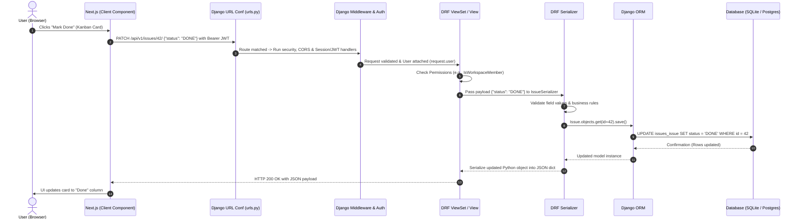
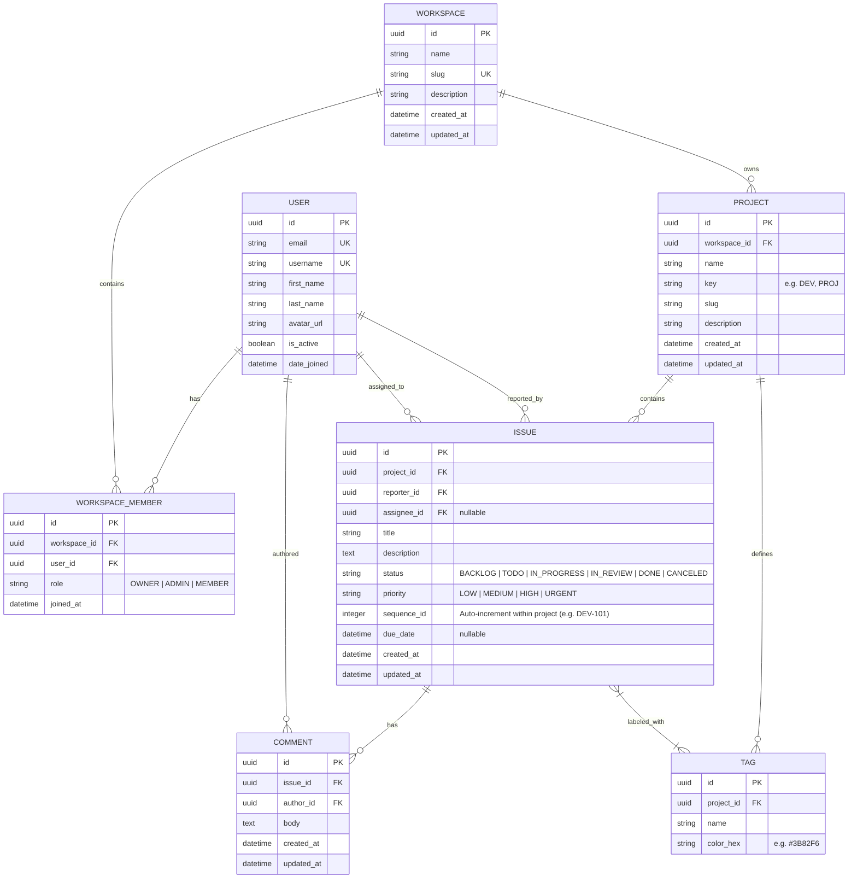

# Phase 1: Project Blueprint and System Architecture

Welcome to **DevFlow**—a modern, production-grade Project & Issue Tracking Workspace modeled after tools like Linear and Jira.

This document establishes the architectural blueprint, mental models, domain boundaries, and database design that will guide our entire development journey.

---

## 1. Architectural Vision: Monolith (MVT) vs. Decoupled (Headless API + Next.js)

### 1.1 The Traditional Django Monolith (Model-View-Template / MVT)
In traditional Django applications:
- The server handles **routing, database access, business logic, AND HTML rendering**.
- The client browser is a "thin client" receiving pre-rendered HTML strings on every request.
- Client interactivity requires sprinkles of JavaScript (e.g., jQuery, Alpine.js, HTMX) or full-page reloads.

```
Traditional Django:
Browser (HTML request) ───> Django View ───> Django Template Engine ───> Browser (Full HTML Page)
```

### 1.2 The Decoupled Architecture (DRF + Next.js)
In **DevFlow**, we decouple the system into two independent systems:
1. **Backend (Django REST Framework)**: Serves strictly as a **Headless JSON API Server**. It possesses no HTML templates, cares nothing about CSS, and is solely responsible for data persistence, validation, authorization, and business logic.
2. **Frontend (Next.js 15+ App Router)**: Serves as the **Presentation and Application Layer**. It runs independently (typically on Node.js/Vercel), manages UI components with React/TypeScript, optimizes asset delivery, and communicates with the backend exclusively over HTTP using JSON payloads.

```
Decoupled Architecture:
Next.js (App Router / React) ───[ HTTP Request / JSON ]───> Django REST Framework ───> PostgreSQL / SQLite
Next.js (App Router / React) <───[ HTTP Response / JSON ]─── Django REST Framework <─── Database Records
```

### 1.3 Why Decoupled?
| Metric / Feature | Traditional Django MVT | Decoupled (DRF + Next.js) |
| :--- | :--- | :--- |
| **User Experience (UX)** | Full-page reloads or partial DOM swaps | Instant, app-like transitions, optimistic UI updates |
| **API Reusability** | Only web UI supported out of the box | One backend serves Web (Next.js), Mobile (React Native/iOS), and 3rd-party integrations |
| **Team Specialization** | Backend developers must juggle templates | Clear separation of concerns: Frontend & Backend can scale independently |
| **State Management** | Ephemeral, relies on server sessions | Rich client-side state (Kanban drag-and-drop, real-time filtering, optimistic updates) |

---

## 2. The Complete Request-Response Lifecycle

To understand full-stack development, you must visualize what happens across the wire when an action occurs.

Below is the lifecycle of a request in DevFlow—for example, when a user changes an issue status from **"In Progress"** to **"Done"**:



### Detailed Breakdown of Each Step:
1. **Client Action**: The user interacts with a React component (e.g., dragging an issue card on a Kanban board).
2. **HTTP Transmission**: Next.js sends an asynchronous `PATCH` request with a JSON body and an `Authorization: Bearer <access_token>` header.
3. **CORS & Middleware**: `django-cors-headers` checks whether the Next.js origin (`http://localhost:3000`) is allowed. SimpleJWT middleware intercepts the token, verifies the cryptographic signature, extracts the user ID, and injects `request.user`.
4. **URL Routing**: Django's `urls.py` parses `/api/v1/issues/42/` and dispatches the request to `IssueViewSet.partial_update`.
5. **Permissions Check**: DRF evaluates permissions (e.g., `IsAuthenticated` and custom `IsWorkspaceMember`). If forbidden, a `403 Forbidden` JSON error is returned immediately.
6. **Serialization & Validation**: DRF's `IssueSerializer` deserializes the raw JSON, checks that `"DONE"` is a valid status choice, and executes validation hooks.
7. **ORM Execution**: The Django Object-Relational Mapper (ORM) compiles the Python call into a SQL statement executed against the database.
8. **Transformation to JSON**: The updated Python model instance is transformed back into a standard Python dictionary by the serializer, then converted to a JSON HTTP response string by DRF's `Response` renderer.
9. **UI Reaction**: Next.js receives the `200 OK` JSON response and reconciles the React state.

---

## 3. Domain Decomposition & The Django "Apps" Philosophy

In Django, an **App** is a self-contained Python package that provides a specific piece of functionality (models, views, serializers, tests, and admin configurations). Rather than building a single sprawling monolith, Django applications are partitioned into modular apps.

DevFlow decomposes its business domain into three primary apps:

```
DevFlow Backend Architecture
├── accounts/    ──> Identity, Authentication, Profiles
├── projects/    ──> Workspaces, Memberships, Projects
└── issues/      ──> Issues, Statuses, Priorities, Tags, Activity
```

### 3.1 `accounts` App
- **Responsibility**: User identity, account lifecycle, authentication credentials.
- **Why Separate?**: Authentication is orthogonal to project tracking. Separating accounts isolates security-critical logic (passwords, JWT generation, user roles).
- **Core Entities**: Custom `User` model (inheriting from `AbstractUser`).

### 3.2 `projects` App
- **Responsibility**: Organizational hierarchy and multi-tenancy.
- **Why Separate?**: Workspaces and projects act as containers for issues. Users belong to workspaces, and workspaces own projects.
- **Core Entities**: `Workspace`, `WorkspaceMember` (junction table with role: `OWNER`, `ADMIN`, `MEMBER`), `Project`.

### 3.3 `issues` App
- **Responsibility**: Work tracking, task lifecycle, and collaboration.
- **Why Separate?**: High-velocity transactional domain. Contains the core issue entities, workflow statuses, tagging, and comments.
- **Core Entities**: `Issue`, `Tag`, `Comment`.

---

## 4. Entity Relationship Diagram (ERD) & Database Schema Design

Below is the complete relational model for DevFlow. We define clear cardinality and cascade behavior before writing a single line of model code.



### 4.1 Relationship Cascade Policies Explained
Understanding `on_delete` behaviors in Django prevents unintended data loss and orphan records:

1. **`CASCADE`**: When the parent record is deleted, all dependent children are automatically deleted.
   - Example: Deleting a `Project` deletes all its `Issue` records. Deleting a `Workspace` deletes its `WorkspaceMember` records.
2. **`SET_NULL`**: When the parent record is deleted, set the foreign key on the child record to `NULL` (requires `null=True`).
   - Example: If an assigned `User` leaves or is deleted, `Issue.assignee` is set to `NULL` so the issue is preserved and unassigned rather than purged.
3. **`PROTECT`**: Prevents deletion of the parent if related children exist.
   - Example: A `Workspace` cannot be deleted if active billable projects exist until they are explicitly archived or transferred.

---

## 5. Monorepo Project Layout & File Organization

We will organize the repository using a clean full-stack monorepo structure:

```text
DEVFLOW/
├── .gitignore                          # Unified ignores for Python, Node, and secrets
├── ROADMAP.md                          # Master curriculum progress tracker
├── Docs/                               # Dedicated phase-by-phase architectural manuals
│   ├── Phase 1 - Project Blueprint and System Architecture.md
│   └── ... (Phase 2 through 10)
│
├── backend/                            # Django REST Framework backend
│   ├── manage.py                       # Django CLI entrypoint
│   ├── devflow_core/                   # Project configuration package
│   │   ├── __init__.py
│   │   ├── settings.py                 # Installed apps, DB, DRF, JWT settings
│   │   ├── urls.py                     # Root API URL routing table
│   │   ├── asgi.py                     # ASGI async server entrypoint
│   │   └── wsgi.py                     # WSGI synchronous server entrypoint
│   ├── accounts/                       # App: Custom User & Authentication
│   ├── projects/                       # App: Workspaces & Projects
│   ├── issues/                         # App: Issues, Tags & Comments
│   ├── requirements.txt                # Python backend dependencies
│   └── .env.example                    # Backend environment template
│
└── frontend/                           # Next.js 15+ App Router frontend
    ├── package.json                    # Node dependencies and scripts
    ├── tsconfig.json                   # TypeScript compiler configuration
    ├── tailwind.config.ts              # Tailwind CSS configuration
    ├── next.config.ts                  # Next.js server configuration
    ├── src/
    │   ├── app/                        # Next.js App Router (pages & layouts)
    │   ├── components/                 # Reusable UI & feature components
    │   ├── lib/                        # API fetcher, auth helpers, utilities
    │   └── types/                      # TypeScript interface definitions
    └── .env.example                    # Frontend environment template
```

---

## 6. Key Takeaways & Architectural Guardrails

1. **APIs Return Data, Not Views**: The Django backend must never import `render` or return HTML. All responses must be JSON generated by DRF `Response` or standard DRF exception handlers.
2. **UUIDs for Public Primary Keys**: We will use UUIDs (`uuid4`) for all public entities (Users, Workspaces, Projects, Issues) to prevent enumeration attacks (e.g., guessing IDs by calling `/api/v1/issues/1`, `/api/v1/issues/2`).
3. **Human-Friendly Keys for UX**: While UUIDs act as primary keys in the database, issues will also feature a human-readable identifier (e.g., `DEV-42`), matching industry standards like Linear and Jira.
4. **Thin Views, Fat Models/Serializers**: Business logic belongs in serializers and model managers, not directly in view handler functions.

---

## 7. Phase Completion Checklist

- [x] Monolithic vs Decoupled mental model established
- [x] Request-Response lifecycle mapped end-to-end
- [x] Domain decomposition into `accounts`, `projects`, and `issues` defined
- [x] Comprehensive Entity Relationship Diagram (ERD) drafted
- [x] Monorepo workspace layout designed
- [x] Root `.gitignore` configured for Python, Django, Node, and Next.js

---

*Proceed to **Phase 2: Django Foundation & Custom User Model** to set up the Python virtual environment, install dependencies, and build our Custom User Model.*
