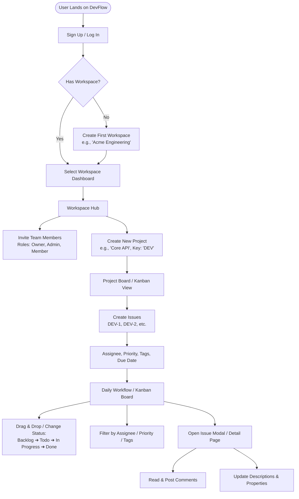

# DevFlow

> A modern, keyboard-first Project & Issue Tracking Workspace inspired by Linear and Jira, built with **Django REST Framework** on the backend and **Next.js** on the frontend.

---

## 🎯 What is DevFlow?

**DevFlow** is a collaborative issue tracking and project management platform built for modern engineering teams. It allows organizations to organize their software engineering workflows across **Workspaces**, manage specific initiatives through **Projects**, and track tasks seamlessly via an interactive **Kanban Board** with automated issue identifiers (such as `DEV-1`, `DEV-2`).

---

## 🧭 The End-to-End User Flow Sequence

Here is the exact journey a user takes when interacting with DevFlow from first visit to daily engineering work:

---

### Step 1: Authentication & Onboarding
1. **Landing & Registration**:
   - A user visits the app (`http://localhost:3000`).
   - If not authenticated, they are prompted to **Register** or **Log In** using their email and password.
2. **Session Establishment**:
   - The Next.js frontend sends credentials to Django's SimpleJWT endpoint (`/api/v1/auth/token/`).
   - Django validates the password and responds with an **Access Token** and **Refresh Token**.
   - Next.js stores the token and redirects the user into the protected app route (`/dashboard`).

---

### Step 2: Workspace Creation & Multi-Tenancy
1. **Workspace Check**:
   - The user's account is checked for existing workspace memberships.
2. **First-Time Setup**:
   - If the user is new, they are guided to create their first workspace (e.g., *"Acme Engineering"*).
   - DevFlow generates a clean URL slug (e.g., `/workspaces/acme-engineering`).
   - The creator is automatically assigned the **`OWNER`** role via `WorkspaceMember`.
3. **Multi-Workspace Switcher**:
   - Users can belong to multiple workspaces (e.g., *Personal*, *Client A*, *Company B*) and switch between them from the top-left workspace selector.

---

### Step 3: Team Collaboration & Role Management
1. **Inviting Members**:
   - A Workspace Owner or Admin can add team members by email.
2. **Role-Based Access**:
   - **`OWNER`**: Full billing, workspace deletion, member management, and project control.
   - **`ADMIN`**: Create/edit projects, invite members, modify project settings.
   - **`MEMBER`**: Create, edit, comment, and move issues within assigned projects.

---

### Step 4: Project Initialization
1. **Creating a Project**:
   - Inside a workspace, a team creates projects representing products or initiatives (e.g., *"Mobile App"*, *"Core Platform"*, *"Marketing Website"*).
2. **Assigning the Key Prefix**:
   - The user designates an uppercase 2–5 character project key (e.g., `DEV`, `MOB`, `WEB`).
   - This key defines the project's issue prefix: every issue in `DEV` will be numbered `DEV-1`, `DEV-2`, `DEV-105`.

---

### Step 5: Issue Creation & Prioritization
1. **Creating an Issue**:
   - The user opens the issue creation modal (or presses a keyboard shortcut like `C`).
2. **Populating Properties**:
   - **Title**: Brief summary (e.g., *"Implement Google OAuth login"*).
   - **Description**: Rich markdown text explaining technical details or acceptance criteria.
   - **Priority**: `LOW`, `MEDIUM`, `HIGH`, or `URGENT`.
   - **Assignee**: Dropdown of members within this workspace.
   - **Tags / Labels**: Project tags such as `Backend`, `Frontend`, `Bug`, `Security`.
   - **Due Date**: Optional target completion date.
3. **Automatic Sequence Assignment**:
   - Django calculates the next sequence integer for this specific project and creates the record.

---

### Step 6: Interactive Kanban Board & Daily Work
1. **Board Layout**:
   - Inside `/projects/[slug]`, issues appear on a multi-column Kanban board:
     - 📋 **Backlog**
     - 📝 **To Do**
     - ⚡ **In Progress**
     - 🔍 **In Review**
     - ✅ **Done**
     - 🚫 **Canceled**
2. **Status Updates**:
   - Developers drag issue cards from column to column or change the status dropdown.
   - The Next.js frontend performs an **optimistic update** (card moves instantly in the UI), while sending a `PATCH /api/v1/issues/<id>/` request in the background.

---

### Step 7: Issue Detail, Comments & Activity
1. **Opening an Issue**:
   - Clicking an issue card opens a detail slide-over or dedicated route (`/projects/core-platform/issues/DEV-42`).
2. **Collaboration & Discussion**:
   - Team members add markdown comments discussing implementation or asking questions.
   - Real-time updates display who commented and when.
3. **Property Tweaking**:
   - Team members can reassign the issue, adjust priority, or add labels without page reloads.

---

### Step 8: Search, Filtering & Deep Linking
1. **Fast Filtering**:
   - Filter bar allows filtering by:
     - *Assignee* (e.g., "Assigned to me")
     - *Priority* (e.g., "Urgent issues only")
     - *Tag* (e.g., "Bug")
     - *Text search* (matches title or description)
2. **URL Synchronization**:
   - All filter criteria synchronize with URL query params:
     `.../projects/core-platform?status=IN_PROGRESS&priority=URGENT`
   - Sharing this URL with a teammate opens the exact filtered view.

---

## 🏗️ Technical Architecture at a Glance

| Component | Technology | Purpose |
| :--- | :--- | :--- |
| **Backend API** | Django 5.2 + Django REST Framework | Business logic, permissions, validation, database ORM |
| **Database** | SQLite (Dev) / PostgreSQL (Prod) | Relational persistence with UUID primary keys |
| **Authentication** | SimpleJWT | Stateless JSON Web Tokens (Access + Refresh tokens) |
| **Frontend UI** | Next.js 15+ (App Router, TypeScript) | Interactive client state, Server Components, Kanban UI |
| **Styling** | Tailwind CSS + Lucide Icons | Clean, responsive, dark-mode-ready UI |

---

## 📚 Curriculum Progress & Documentation

- [ROADMAP.md](ROADMAP.md): Detailed 10-phase learning curriculum and progress tracker.
- [Docs/Phase 1 - Project Blueprint and System Architecture.md](Docs/Phase%201%20-%20Project%20Blueprint%20and%20System%20Architecture.md): Architectural deep-dive and ERD.
- [Docs/Phase 2 - Django Foundation and Custom User Model.md](Docs/Phase%202%20-%20Django%20Foundation%20and%20Custom%20User%20Model.md): Django setup & Custom User model.
- [Docs/Phase 3 - Domain Modeling and Database Relationships.md](Docs/Phase%203%20-%20Domain%20Modeling%20and%20Database%20Relationships.md): Workspaces, Projects, Issues, and relational schemas.
